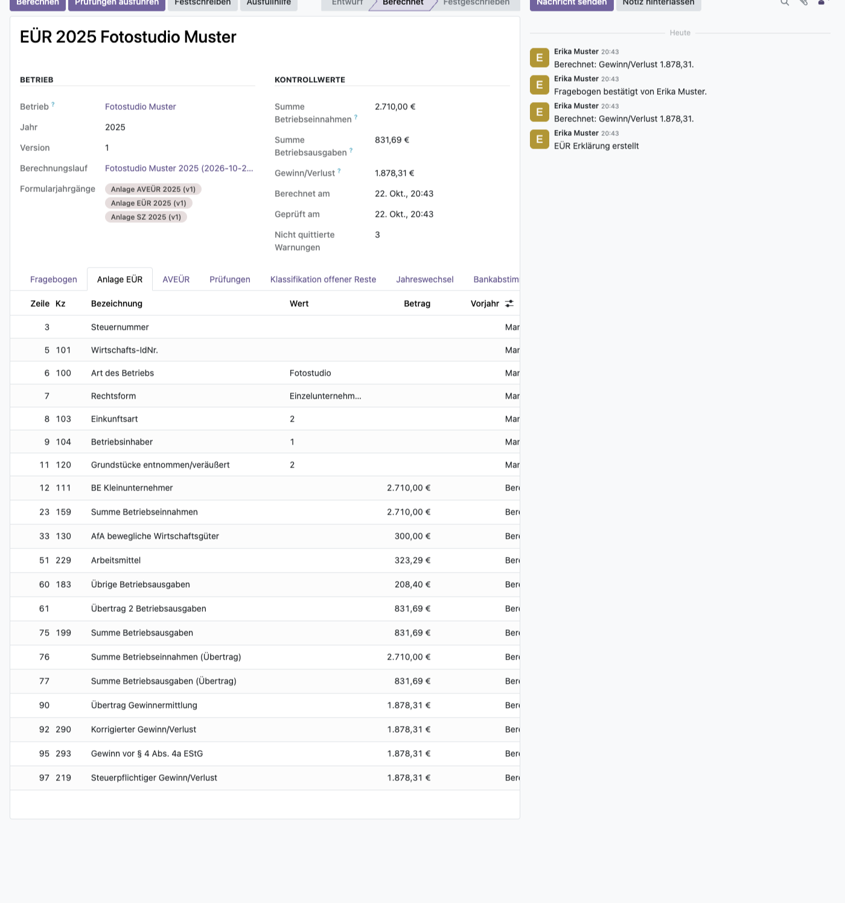
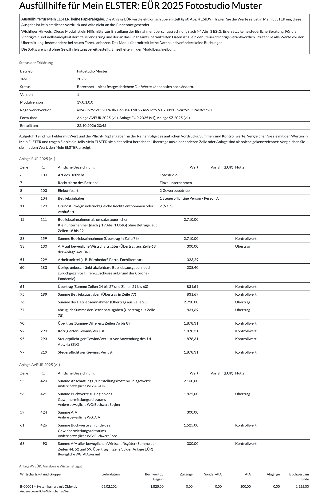
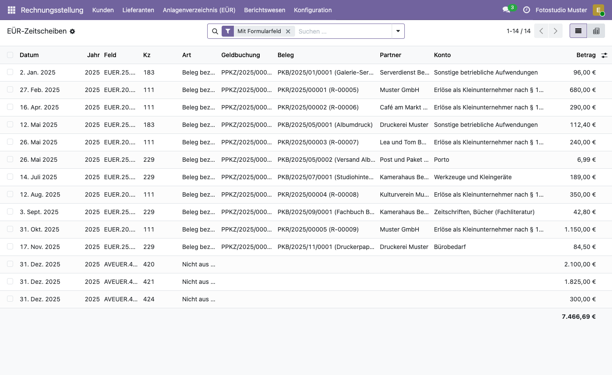
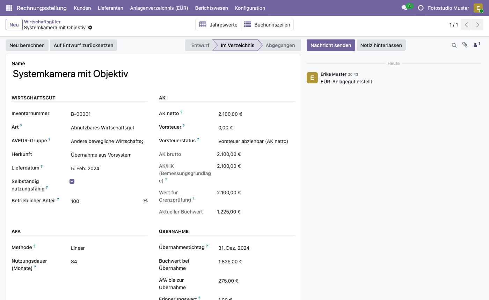

# Deutsche EÜR für Odoo
<!-- /!\ Non OCA Context : Set here the badge of your runbot / runboat instance. -->

<!-- /!\ Non OCA Context : Set here the badge of your translation instance. -->

<!-- /!\ do not modify above this line -->

Einnahmenüberschussrechnung (EÜR) nach § 4 Abs. 3 EStG für Odoo 19: die amtlichen
Vordrucke Anlage EÜR, AVEÜR und SZ, ein Anlagenverzeichnis mit Abschreibungen und eine
Ausfüllhilfe für Mein ELSTER – berechnet aus den Buchungen, die ohnehin in Odoo stehen.

> **Alpha, nicht unabhängig geprüft:** Berechnung, Musterfälle und Formulardaten hat
> bisher nur der Maintainer erstellt und geprüft; eine Prüfung durch eine Steuerfachkraft
> steht noch aus. Die Formularjahrgänge werden als Entwurf ausgeliefert, eine Erklärung
> lässt sich erst nach ihrer Freigabe durch eine fachkundige Person abschließen. Das Modul
> ersetzt keine steuerliche Beratung; die Software wird ohne Gewährleistung bereitgestellt
> (AGPL-3.0, Abschnitte 15 und 16).

## Was das Modul kann

- **Zufluss und Abfluss** (§ 11 EStG) direkt aus den Bank- und Kassenzeilen in Odoo; jeder
  Betrag lässt sich bis zum Beleg zurückverfolgen.
- **Amtliche Vordrucke 2024–2026** (Anlage EÜR, AVEÜR, SZ) als Daten: Zeilen, Kennzahlen,
  amtlicher Wortlaut, Summen und Überträge.
- **Kleinunternehmer und Regelbesteuerung**, Privatanteile, Geschenke, Bewirtung,
  Umsatzsteuer-Zahlungen und die **10-Tage-Regel** mit einer Prüfliste zum Jahreswechsel.
- **Anlagenverzeichnis** mit linearer und degressiver AfA, GWG, Sammelposten und Anlage AVEÜR.
- **Prüfungen vor dem Abschluss**, Festschreibung mit Prüfsumme und Korrekturversionen.
- **Ausgaben:** Ausfüllhilfe für Mein ELSTER (HTML und PDF), Nachweis je Kennzahl bis zum
  Beleg, Verzeichnisse nach § 4 Abs. 7 EStG, Kennzahlen als CSV und JSON, Datenpaket Z3
  (§ 147 Abs. 6 AO), Prüfprotokoll und eine Vorlage der Verfahrensdokumentation.

## Schnellstart

1. **Installieren:** Odoo 19 (Community oder Enterprise) mit deutschem Kontenrahmen SKR03
   oder SKR04 (`l10n_de`). Den Ordner `l10n_de_euer` in den Addons-Pfad legen und unter
   *Apps* das Modul „Deutsche EÜR“ installieren.
2. **Einrichten:** *Rechnungsstellung → Konfiguration → EÜR → EÜR einrichten*: EÜR für die
   Firma einschalten, Art des Betriebs, Rechtsform und Einkunftsart eintragen und die
   umsatzsteuerliche Behandlung wählen (Kleinunternehmer oder Regelbesteuerung).
3. **Konten prüfen:** *Rechnungsstellung → Berichtswesen → EÜR → Kontenzuordnung prüfen*
   zeigt, welches Konto in welche Zeile des Vordrucks fließt; unsichere Zuordnungen
   bestätigen oder ändern.
4. **Im Jahr buchen wie gewohnt:** Rechnungen, Belege und Kontoauszüge bis zum 31.12.
   importieren und abgleichen.
5. **Erklärung rechnen:** *Rechnungsstellung → Berichtswesen → EÜR → Jahreserklärungen →
   Neu*, Jahr wählen, *Berechnen*.
6. **Durchgehen:** Fragebogen beantworten, offene Reste einordnen, die Prüfliste zum
   Jahreswechsel (10-Tage-Regel) entscheiden, den Kontostand zum 31.12. eintragen und
   *Prüfungen ausführen*. Jede Zeile führt per Klick zu den Zahlungen und Belegen dahinter.
7. **Abschließen:** Den Formularjahrgang von einer fachkundigen Person freigeben lassen, die
   die Daten nicht erstellt hat, dann *Festschreiben*.
8. **Übertragen:** *Ausfüllhilfe* öffnen und die Werte in Mein ELSTER eintragen. Das Modul
   selbst sendet nichts an das Finanzamt.

## Screenshots

Ausfüllhilfe für Mein ELSTER mit allen Werten, Hinweisen zu fehlenden Angaben und der
Anlage AVEÜR je Wirtschaftsgut:

Jeder Betrag der Erklärung als Zeitscheibe mit Geldbuchung, Beleg, Partner und Konto:

Wirtschaftsgut im Anlagenverzeichnis mit Abschreibung und Übernahme aus dem Vorsystem:

Die Screenshots zeigen das erfundene „Fotostudio Muster“ (Kleinunternehmer). Es lässt
sich mit dem Beispielexport aus
[odoo-papierkram-import](https://github.com/BM1-de/odoo-papierkram-import) selbst
nachbauen.

## Daten aus Papierkram übernehmen

Wer bisher mit [Papierkram](https://www.papierkram.de) gearbeitet hat, übernimmt Kontakte,
Rechnungen, Belege, Zahlungen und Anlagegüter mit den Modulen aus
[BM1-de/odoo-papierkram-import](https://github.com/BM1-de/odoo-papierkram-import); die
Anlagegüter landen dabei direkt im Anlagenverzeichnis dieses Moduls.

## Mehr Dokumentation

Die ausführliche Beschreibung aller Funktionen, Einstellungen und Grenzen (englisch) steht
in [l10n_de_euer/README.rst](l10n_de_euer/README.rst); den Ablauf einer Veröffentlichung
beschreibt [RELEASE.md](RELEASE.md), Sicherheitsmeldungen [SECURITY.md](SECURITY.md).

*English: German cash-basis profit statement (Einnahmenüberschussrechnung, § 4 (3) EStG)
for Odoo 19 with the official forms Anlage EÜR, AVEÜR and SZ 2024–2026, an asset register
and a fill-in aid for Mein ELSTER. Alpha, not independently checked: form years ship as
drafts. No tax advice, no warranty.*

<!-- /!\ do not modify below this line -->

<!-- prettier-ignore-start -->

[//]: # (addons)

Available addons
----------------
addon | version | maintainers | summary
--- | --- | --- | ---
[l10n_de_euer](l10n_de_euer/) | 19.0.1.0.0 |  | Cash-basis profit statement (Anlage EÜR, AVEÜR) according to § 4 (3) EStG

[//]: # (end addons)

<!-- prettier-ignore-end -->

## Licenses

This repository is licensed under [AGPL-3.0](LICENSE).

However, each module can have a totally different license, as long as they adhere to Baumgärtner Marketing GmbH
policy. Consult each module's `__manifest__.py` file, which contains a `license` key
that explains its license.

----
<!-- /!\ Non OCA Context : Set here the full description of your organization. -->
